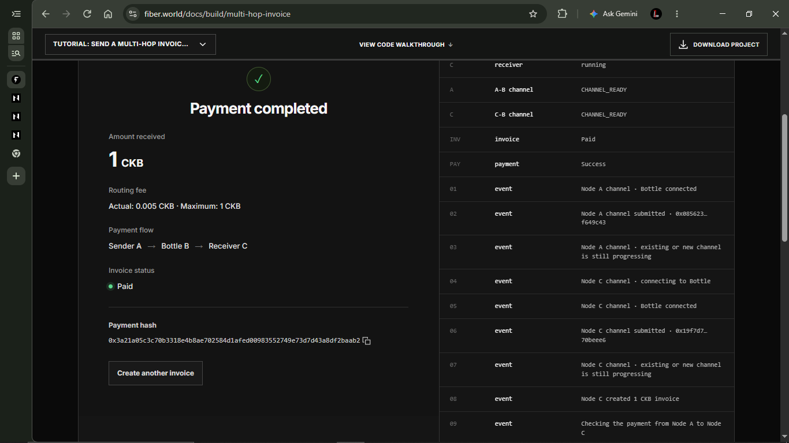
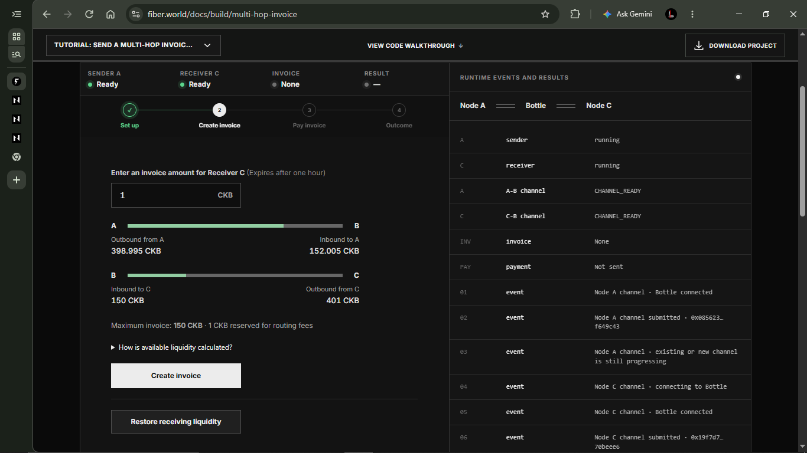
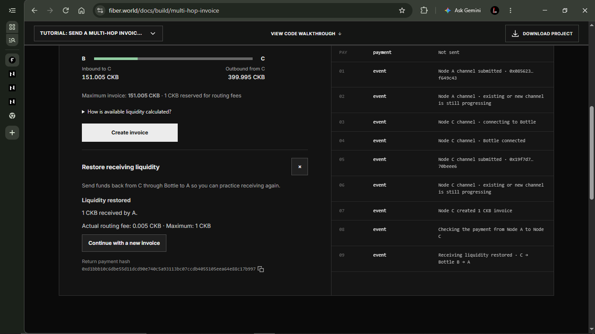
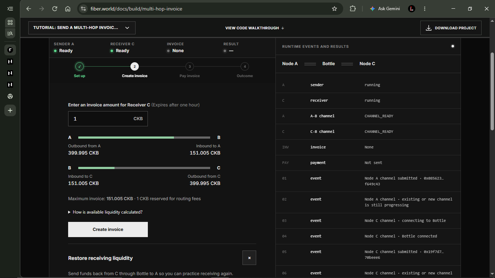
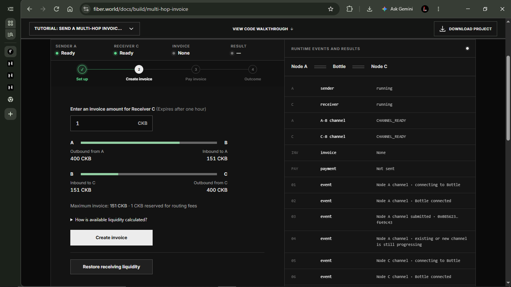

## Send Your First Multi-Hop Payment with Fiber

Proof of completion for the [Send a Multi-Hop Invoice Payment](https://www.fiber.world/docs/build/multi-hop-invoice) tutorial, completed with the hosted demo on Fiber Testnet.

**Route:** Sender A → Bottle B (public trampoline node) → Receiver C


## 1. Quest 1: Send a multi-hop invoice payment

Sent 1 CKB from A to C through Bottle.

- **Payment hash:** `0x3a21a05c3c70b3318e4b8ae702584d1afed00983552749e73d7d43a8df2baab2`
- **Actual routing fee:** 0.005 CKB (maximum 1 CKB)



## 2. Quest 2: Restore receiving liquidity

Sent 1 CKB back from C to A through the same channels.

- **Return payment hash:** `0xd1bbb10c6dbe55d11dcd90e740c5a93113bc07ccdb4055105eea64e88c17b997`
- **Actual routing fee:** 0.005 CKB (maximum 1 CKB)

**Before the return payment**



**Liquidity restored**



**After the return payment**




## 3. Liquidity answer

**Before the return payment**

Before I sent 1 CKB back, the A–B bar showed A with 398.995 and Bottle with 152.005, and the B–C bar showed Bottle with 150 and C with 401. The "Inbound to C" figure of 150 is not C's money: it is Bottle's balance on the B–C channel, which Bottle can push toward C.

**What changed on the B–C channel**

C's side dropped from 401 to 399.995 (−1.005) and Bottle's side rose from 150 to 151.005 (+1.005). Bottle's side grew by more than 1 CKB because C had to send the 1 CKB payment plus Bottle's 0.005 forwarding fee into the channel.

**What changed on the A–B channel**

Bottle's side fell from 152.005 to 151.005 (−1) and A's side rose from 398.995 to 399.995 (+1). A gained exactly 1 CKB because Bottle kept the fee on the B–C hop and forwarded only the payment amount to A.

**Why this helps C receive another payment**

C can only receive as much as Bottle holds on its side of the B–C channel, because every payment to C has to move from Bottle's side to C's side. After the return payment, Bottle's side grew, so the maximum invoice C can receive rose from 150 to 151.005. Both channel totals stayed at 551 CKB, so no new money was added; the existing funds just shifted position inside each channel.

**Fees I observed**

Each payment cost a 0.005 CKB fee: A paid it on the first payment and C paid it on the return payment, so Bottle earned 0.010 CKB in total for forwarding. This was higher than the 0.001 CKB in the docs example but far below the tutorial's 1 CKB budget, which is only a maximum, not the actual charge. The difference from the docs example is likely because Bottle's node uses a higher fee rate, about 0.5% (0.005 on 1 CKB) instead of 0.1%.

**Anything unexpected**

After the round trip, the maximum invoice C could receive ended at 151.005, slightly above the original 151, because the 0.005 fee C paid on the return stayed on Bottle's side of B–C.


## 4. Liquidity Ledger

### A. Three-snapshot ledger

| | Outbound from A | Inbound to A (Bottle) | A–B total | Inbound to C (Bottle) | Outbound from C | B–C total | Max invoice |
|---|---|---|---|---|---|---|---|
| **S1 Baseline** | 400 | 151 | 551 | 151 | 400 | 551 | 151 |
| Predicted S2 | 398.995 | 152.005 | 551 | 150 | 401 | 551 | 150 |
| **S2 After Q1** | 398.995 | 152.005 | 551 | 150 | 401 | 551 | 150 |
| Predicted S3 | 399.995 | 151.005 | 551 | 151.005 | 399.995 | 551 | 151.005 |
| **S3 After Q2** | 399.995 | 151.005 | 551 | 151.005 | 399.995 | 551 | 151.005 |

All values in CKB. Baseline screenshot:



**Self-checks**

- ✅ The A–B and B–C totals stayed at 551 CKB in every snapshot. Payments moved funds; none were created or lost.
- ✅ A ended 0.005 CKB lower (400 → 399.995), matching the Quest 1 fee.
- ✅ C ended 0.005 CKB lower (400 → 399.995), matching the Quest 2 fee.
- ✅ Bottle ended 0.005 CKB higher on each channel, a total gain of 0.010 CKB (both fees).
- ✅ Maximum invoice went 151 → 150 → 151.005.

**What the return payment changed**

| Channel | Side | Before | After | Change |
|---|---|---|---|---|
| B–C | Inbound to C (Bottle) | 150 | 151.005 | +1.005 |
| B–C | Outbound from C | 401 | 399.995 | −1.005 |
| A–B | Inbound to A (Bottle) | 152.005 | 151.005 | −1 |
| A–B | Outbound from A | 398.995 | 399.995 | +1 |

### B. Predict, then verify

Before the first payment, I didn't know what Bottle would charge, so I wrote down two possible outcomes: about 0.001 CKB (the 0.1% example in the routing docs) or the full 1 CKB trampoline budget. The real fee turned out to be 0.005 CKB, which matched neither guess. Once I knew the fee, I predicted the bar values before sending each payment, and both times every number on the screen matched my prediction to three decimal places.

### C. Fee analysis

| | Quest 1 | Quest 2 |
|---|---|---|
| Actual fee | 0.005 CKB | 0.005 CKB |
| 0.1% docs example | 0.001 CKB | 0.001 CKB |
| Trampoline budget | 1 CKB | 1 CKB |
| Paid by | A | C |

Both payments cost 0.005 CKB. That is five times the 0.1% example in the docs, but only half a percent of the 1 CKB budget the tutorial allows. The trampoline docs explain that the sender locks the amount plus the whole budget on the way to Bottle, and Bottle may keep up to that budget, so a fee close to 1 CKB was possible. Bottle took far less, and it charged exactly the same in both directions. My best guess is that Bottle charges a fixed rate of about 0.5% and keeps only that, though I can't confirm Bottle's settings from inside the tutorial.

The fee also has nothing to do with the 99 CKB reserve. Each side of a channel keeps 99 CKB locked for closing it on-chain. That's why my 499 CKB channels showed 400 CKB available, and why Bottle's side showed 151, which suggests Bottle put in 250 CKB. The reserves never moved during either payment. Only the two 0.005 CKB fees changed hands, and both ended up with Bottle.

### D. Channel diagram

```text
                 A side     Bottle side        Bottle side   C side
S1 Baseline:   A [400     | 151    ] Bottle [151     | 400    ] C
S2 After Q1:   A [398.995 | 152.005] Bottle [150     | 401    ] C   ← C's receiving room dropped to 150
S3 After Q2:   A [399.995 | 151.005] Bottle [151.005 | 399.995] C   ← Bottle's side toward C refilled
```


## 5. Personal reflection

**What I learned about the liquidity needed on the A–B and B–C channels**

For A to pay C, the money had to be on the sending side of each hop: A needed enough on its side of A–B to send 1.005 CKB to Bottle, and Bottle needed enough on its side of B–C to forward 1 CKB to C. The maximum invoice of 151 instead of 400 surprised me at first, because C clearly had about 400 CKB. It taught me that C's own balance doesn't help it receive at all; what limits receiving is how much the other party (Bottle) holds on its side of the channel. Having money and being able to receive money are two different things in a payment channel.

**Why I think multi-hop payments are useful**

Opening a channel with every person I pay would mean locking up funds and paying on-chain fees each time, which doesn't make sense for someone I only pay once or occasionally. For example, if I buy something small from an online seller I'll probably never buy from again, I'd rather route the payment through a hub I'm already connected to than open a channel just for that one purchase. Multi-hop lets one well-funded channel reach many people.

**What I found confusing, unexpected, or interesting**

The fee was 0.005 CKB per payment, five times the 0.001 in the docs example, and the tutorial only mentions a 1 CKB maximum without saying where 0.005 comes from. I worked out that Bottle seems to charge about 0.5% instead of the 0.1% in the docs, and that the 1 CKB budget is only a cap. It was also interesting that after the round trip, A and C each ended at 399.995 while Bottle gained exactly 0.010, so I could trace every fraction of a CKB.

**A problem I encountered**

I expected to start the payment steps straight away, but both browser nodes started with 0 CKB, so nothing could be opened or paid. I fixed it by funding A and C separately from the faucet and then waiting for each balance to update before moving on. It made me realise that both of my nodes needed their own funds: even C, which only receives, had to fund its own channel, although that money didn't help it receive.

**What I would like to build**

I'd build a pay-per-download page for small digital assets, such as icons, mockup templates or UI kits, where a buyer pays the creator a small amount per file through a hub instead of through a card processor. The creator's node issues an invoice for each download and the buyer's browser node pays it over a multi-hop route. A browser node suits this because buyers wouldn't need to install anything or run a full node; they could pay from the same tab they're browsing in, and tiny payments make sense because the fees are so small.

**How I would improve the tutorial or reading materials**

In the payment step, I'd show Bottle's fee rate or explain how the actual fee is worked out next to the 1 CKB maximum, because I had no way to tell from the tutorial why I was charged 0.005. On the liquidity bars, I'd label each side with its owner, for example "Bottle's balance (C can receive this)" instead of "Inbound to C", and add a short note beside the maximum invoice saying which side is limiting it; I only understood why it was 151 after reading the article text. In the event log, I'd add a final "channel ready" event or clear the "existing or new channel is still progressing" message once both channels reach CHANNEL_READY, because seeing that message after the channels were ready made me think something was still wrong.


## References

- [Send a Multi-Hop Invoice Payment](https://www.fiber.world/docs/build/multi-hop-invoice)
- [Multi-Hop Payments](https://www.fiber.world/docs/concept/routing/multi-hop)
- [Understanding Fiber Liquidity](https://www.fiber.world/docs/concept/liquidity/overview)
- [Trampoline Routing](https://www.fiber.world/docs/concept/routing/trampoline-routing)